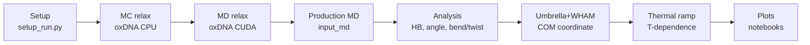

# DNA nanotweezer simulations: scripts by workflow

oxDNA simulations of nanotweezers (nanotw, T3IVT) with umbrella sampling.

Data are not in this repo: see `FILES.md` in the Yunshi_data folder on the USB drive.

HTML twin: DNA.html. Hard-coded cluster paths: [PORTABILITY.md](PORTABILITY.md). Versions: [VERSIONS.md](VERSIONS.md). Run scripts inside the simulation or analysis directory.

## Workflow at a glance



## Script to task

| Task | Scripts |
|---|---|
| [1. Setup of a run](#1-setup-of-a-run) | `dna/setup/setup_run.py`, `dna/setup/replacer.py`, `dna/setup/setup_equil_cmds.py`, `dna/setup/multimer_forces.py`, `dna/setup/setup_analysis.py, prepare_oat_workflow.py` |
| [2. MC / MD relaxation](#2-mc--md-relaxation) | `templates/dna/input_pre_relax`, `templates/dna/input_cuda_relax`, `jobs/dna/mcjob.sh, mdjob.sh, cpu_mono.sh, queue_relax.sh, equil_job.sh` |
| [3. Production MD](#3-production-md) | `templates/dna/input_md`, `jobs/dna/prod_job.sh, queue_25_prod.sh` |
| [4. Analysis](#4-analysis) | `dna/analysis/hb_cal.py, total_hbond_cal.py`, `dna/analysis/signed_helical_bent_twist_cal.py`, `dna/analysis/angle_cal.py`, `dna/analysis/distance_cal.py, distance_two_sets.py`, `dna/analysis/helical_bent_twist_cal.py, helix_bt.py, twist_bent.py, tb2.py`, `dna/analysis/calculate_bond.py, calculate_bond_instability.py`, `dna/analysis/dis_*_plotter.py, plot_energydat.py`, `dna/multimer/multimer_tb.py` |
| [5. Umbrella sampling and WHAM](#5-umbrella-sampling-and-wham) | `dna/umbrella/setup_umb.py`, `dna/umbrella/setup_umbrella.py, setup_prod.py`, `dna/umbrella/tune_stiff.py`, `dna/umbrella/run_all.sh, run_production_only.sh, try.sh`, `dna/umbrella/check_equil.py, check_dis.py`, `dna/umbrella/wham_cal.py, wham_com.py, wham_calculate.py`, `dna/umbrella/tb_wham.py`, `dna/umbrella/force_from_pmf.py, compute_barrier_forces.py`, `dna/umbrella/2state.py, state_average.py, delta_energy.py`, `dna/umbrella/plot_*.py, pwindow.py` |
| [6. Thermal ramp](#6-thermal-ramp) | `dna/thermal_ramp/thermal_ramp_setup.py, wrap_thermal_ramp.py` |
| [7. Plotting notebooks](#7-plotting-notebooks) | `notebooks/dna/plot_analysis_results.ipynb, plot_energy.ipynb, plot_curves.ipynb` |

## 1. Setup of a run

### `dna/setup/setup_run.py`

- **When:** First step for a new nanotweezer structure; same logic as RNA version.
- **Gloss:** oxDNA: coarse-grained DNA model.
- **In / out:** Out: relax/md/analysis dirs + cmds_relax. Three versions differ only in absolute paths (/home/donglifan vs /home/dfan).
- **Version:** canonical = newest copy; 3 older distinct version(s) in `archive/setup_run/`.

```bash
python setup_run.py
```

### `dna/setup/replacer.py`

- **When:** Fill file names into input files.
- **In / out:** 
- **Version:** single version.

```bash
python replacer.py
```

### `dna/setup/setup_equil_cmds.py`

- **When:** Command list for equilibration stages.
- **In / out:** 
- **Version:** canonical = newest copy; 1 older distinct version(s) in `archive/setup_equil_cmds/`.

### `dna/setup/multimer_forces.py`

- **When:** Linker forces to build a multimer (MONOMER_LENGTH 258; A/B/C/D pair positions).
- **Gloss:** Mutual trap: harmonic spring between two nucleotides.
- **In / out:** Out: forces file.
- **Version:** single version.

### `dna/setup/setup_analysis.py, prepare_oat_workflow.py`

- **When:** Write analysis command lists (as for RNA).
- **In / out:** Out: cmds.sh.
- **Version:** canonical = newest copy; 1 older distinct version(s) in `archive/setup_analysis/`.

## 2. MC / MD relaxation

### `templates/dna/input_pre_relax`

- **When:** MC pre-relax on CPU.
- **Gloss:** MC: Metropolis random moves.
- **In / out:** 
- **Version:** single version.

```bash
oxDNA input_pre_relax
```

### `templates/dna/input_cuda_relax`

- **When:** CUDA MD relax.
- **In / out:** 
- **Version:** single version.

```bash
oxDNA input_cuda_relax
```

### `jobs/dna/mcjob.sh, mdjob.sh, cpu_mono.sh, queue_relax.sh, equil_job.sh`

- **When:** Slurm jobs for these stages.
- **In / out:** 
- **Version:** single version.

```bash
sbatch mdjob.sh
```

## 3. Production MD

### `templates/dna/input_md`

- **When:** Production template.
- **In / out:** 
- **Version:** single version.

### `jobs/dna/prod_job.sh, queue_25_prod.sh`

- **When:** Slurm production jobs.
- **In / out:** 
- **Version:** canonical = newest copy; 2 older distinct version(s) in `archive/prod_job/`.

```bash
sbatch prod_job.sh
```

## 4. Analysis

### `dna/analysis/hb_cal.py, total_hbond_cal.py`

- **When:** Hydrogen-bond counts for a nucleotide set / all.
- **Gloss:** Hydrogen bond (hb_list observable).
- **In / out:** Same CLI as RNA.
- **Version:** single version.

```bash
python hb_cal.py input.txt trj.dat idx.csv --output HB.csv
```

### `dna/analysis/signed_helical_bent_twist_cal.py`

- **When:** Signed bend and twist (current).
- **Gloss:** Bend: angle between long-helix axes; twist about the long-helix axis.
- **In / out:** Out: twist_bend.csv.
- **Version:** single version.

```bash
python signed_helical_bent_twist_cal.py align.dat junctions.txt
```

### `dna/analysis/angle_cal.py`

- **When:** Angle between two helices by PCA axes.
- **Gloss:** PCA axis: principal direction of the nucleotide positions.
- **In / out:** In: trj.dat helices.csv. Out: angles.csv.
- **Version:** single version.

```bash
python angle_cal.py trj.dat helices.csv
```

### `dna/analysis/distance_cal.py, distance_two_sets.py`

- **When:** Distance between two nucleotides / COM of two groups.
- **Gloss:** COM: centre of mass.
- **In / out:** 
- **Version:** single version.

```bash
python distance_two_sets.py a.csv b.csv x.dat
```

### `dna/analysis/helical_bent_twist_cal.py, helix_bt.py, twist_bent.py, tb2.py`

- **When:** Earlier bend/twist variants.
- **In / out:** 
- **Version:** single version.

### `dna/analysis/calculate_bond.py, calculate_bond_instability.py`

- **When:** Bond occupancy and Bond Instability Index.
- **Gloss:** BII = 4p(1-p).
- **In / out:** 
- **Version:** single version.

### `dna/analysis/dis_*_plotter.py, plot_energydat.py`

- **When:** Plots vs distance / energy.
- **In / out:** 
- **Version:** single version.

### `dna/multimer/multimer_tb.py`

- **When:** Per-monomer bend/twist for k-mers.
- **In / out:** 
- **Version:** canonical = newest copy; 2 older distinct version(s) in `archive/multimer_tb/`.

```bash
python multimer_tb.py traj.dat junctions.txt k
```

## 5. Umbrella sampling and WHAM

### `dna/umbrella/setup_umb.py`

- **When:** Windows along a COM-COM or nucleotide-pair coordinate.
- **Gloss:** Umbrella sampling: harmonic bias windows.
- **In / out:** Out: window_NN/equil\|prod, a_coord.txt, b_coord.txt (COM groups).
- **Version:** canonical = newest copy; 2 older distinct version(s) in `archive/setup_umb/`.

```bash
python setup_umb.py parameters.txt
```

### `dna/umbrella/setup_umbrella.py, setup_prod.py`

- **When:** Alternative setup / production regeneration.
- **In / out:** 
- **Version:** single version.

### `dna/umbrella/tune_stiff.py`

- **When:** Rewrite stiffness/steps.
- **In / out:** 
- **Version:** canonical = newest copy; 2 older distinct version(s) in `archive/tune_stiff/`.

```bash
python tune_stiff.py NEW_STIFF NEW_STEPS NEW_PRINT_CONF NEW_PRINT_ENERGY
```

### `dna/umbrella/run_all.sh, run_production_only.sh, try.sh`

- **When:** Generated drivers. run_all.sh holds /Users/a000000/db paths from the umbrella_DNA_opening version.
- **In / out:** 
- **Version:** canonical = newest copy; 2 older distinct version(s) in `archive/run_all/`.

```bash
bash run_all.sh
```

### `dna/umbrella/check_equil.py, check_dis.py`

- **When:** Equilibration and distance checks (auto-generated per window).
- **In / out:** 
- **Version:** canonical = newest copy; 2 older distinct version(s) in `archive/check_equil/`.

### `dna/umbrella/wham_cal.py, wham_com.py, wham_calculate.py`

- **When:** WHAM; wham_calculate uses COM from a_coord/b_coord (80 bins, max 10000 frames per window, 0.8518 nm per sim unit).
- **Gloss:** WHAM: reweights biased windows into one PMF.
- **In / out:** Out: PMF.
- **Version:** canonical = newest copy; 1 older distinct version(s) in `archive/wham_cal/`.

```bash
python wham_calculate.py
```

### `dna/umbrella/tb_wham.py`

- **When:** Apparent PMFs of twist and bend over windows (no reweighting).
- **Gloss:** T = 300 K, 80 bins.
- **In / out:** In: helices.csv. Out: pmf_twist.dat, pmf_bend.dat + violin plots.
- **Version:** single version.

```bash
python tb_wham.py helices.csv
```

### `dna/umbrella/force_from_pmf.py, compute_barrier_forces.py`

- **When:** Force profile and barrier analysis.
- **In / out:** 
- **Version:** single version.

### `dna/umbrella/2state.py, state_average.py, delta_energy.py`

- **When:** Two-state populations and DeltaG.
- **Gloss:** DeltaG = -kBT ln(P_closed/P_open).
- **In / out:** 
- **Version:** single version.

### `dna/umbrella/plot_*.py, pwindow.py`

- **When:** Plots.
- **In / out:** 
- **Version:** single version.

## 6. Thermal ramp

### `dna/thermal_ramp/thermal_ramp_setup.py, wrap_thermal_ramp.py`

- **When:** Per-step inputs and joined trajectory (same as RNA).
- **In / out:** 
- **Version:** canonical = newest copy; 1 older distinct version(s) in `archive/thermal_ramp_setup/`.

```bash
python thermal_ramp_setup.py -s 37 -e 4 -t 10 -input input_md
```

## 7. Plotting notebooks

### `notebooks/dna/plot_analysis_results.ipynb, plot_energy.ipynb, plot_curves.ipynb`

- **When:** Results, energy and angle distribution plots.
- **In / out:** In: angles.csv, twist_bend.csv.
- **Version:** canonical = newest copy; 3 older distinct version(s) in `archive/plot_analysis_results/`.

## Unclear / caveats

- No FFS scripts exist for DNA in the sources.
- dna/umbrella/try.sh purpose is **unclear**.
- umbrella_DNA/us_k1 and umbrella_k1 were classified as RNA by name; confirm.
