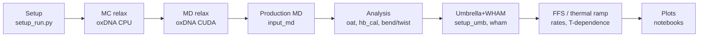

# RNA kissing-loop simulations: scripts by workflow

oxRNA simulations of kissing-loop designs 2H, K1, T3, IVT (monomer and 8mer). Follow sections top to bottom.

Data are not in this repo: see `FILES.md` in the Yunshi_data folder on the USB drive.

HTML twin: RNA.html. Hard-coded cluster paths: [PORTABILITY.md](PORTABILITY.md). Versions: [VERSIONS.md](VERSIONS.md). Run scripts inside the simulation or analysis directory.

## Workflow at a glance



## Script to task

| Task | Scripts |
|---|---|
| [1. Setup of a run](#1-setup-of-a-run) | `rna/setup/setup_run.py`, `rna/setup/replacer.py`, `rna/setup/special_replacer.py`, `rna/setup/mt_creater.py`, `rna/setup/al_mt_creater.py`, `rna/setup/multimerforce.py`, `rna/setup/force_remover.py`, `rna/setup/ntremover.py`, `templates/rna/input_pre_relax, input_cuda_relax, input_md` |
| [2. MC / MD relaxation](#2-mc--md-relaxation) | `templates/rna/input_pre_relax`, `templates/rna/input_cuda_relax`, `jobs/rna/queue.sh` |
| [3. Production MD](#3-production-md) | `templates/rna/input_md`, `jobs/rna/queue_25_prod.sh` |
| [4. Analysis of trajectories](#4-analysis-of-trajectories) | `rna/setup/setup_analysis.py`, `rna/setup/prepare_oat_workflow.py`, `rna/analysis/hb_cal.py`, `rna/analysis/total_hbond_cal.py`, `rna/analysis/calculate_bond_instability.py`, `rna/analysis/log_transformer.py`, `rna/analysis/plot_bond_instability.py`, `rna/analysis/calculate_bond.py`, `rna/analysis/signed_helical_bent_twist_cal.py`, `rna/analysis/helical_bent_twist_cal.py`, `rna/analysis/helix_bt.py, twist_bent.py, tb2.py`, `rna/analysis/distance_cal.py`, `rna/analysis/dis_bent_plotter.py, dis_twist_plotter.py, dis_bond_plotter.py, dis_energy_plotter.py`, `rna/analysis/plot_energydat.py`, `rna/analysis/persistence_length.py`, `rna/multimer/multimer_tb.py`, `rna/multimer/pairwise_tb.py` |
| [5. Umbrella sampling and WHAM](#5-umbrella-sampling-and-wham) | `rna/umbrella/setup_umb.py`, `rna/umbrella/setup_prod.py`, `rna/umbrella/tune_stiff.py`, `rna/umbrella/run_all.sh, run_prod.sh, run_production_only.sh`, `rna/umbrella/check_equil.py`, `rna/umbrella/check_dis.py`, `rna/umbrella/wham_cal.py, wham_com.py, wham_calculate.py`, `rna/umbrella/force_from_pmf.py`, `rna/umbrella/compute_barrier_forces.py`, `rna/umbrella/2state.py, state_average.py`, `rna/umbrella/plot_window.py, pwindow.py, plot_complete.py, plot_completed.py, plot_com_by_window.py` |
| [6. Forward flux sampling (FFS)](#6-forward-flux-sampling-ffs) | `rna/ffs/setup_kl_ffs.py`, `rna/ffs/ffs_flux.py`, `rna/ffs/ffs_shoot.py`, `rna/ffs/extract_conf_hb.py` |
| [7. Thermal ramp](#7-thermal-ramp) | `rna/thermal_ramp/thermal_ramp_setup.py`, `rna/thermal_ramp/run_thermal_ramp.sh`, `rna/thermal_ramp/wrap_thermal_ramp.py` |
| [8. Plotting notebooks](#8-plotting-notebooks) | `notebooks/rna/plot_energy.ipynb`, `notebooks/rna/plot_analysis_results.ipynb`, `notebooks/rna/plot_multimer.ipynb`, `notebooks/rna/cross_plotter.ipynb, plot_monos.ipynb, figure_template.ipynb` |

## 1. Setup of a run

### `rna/setup/setup_run.py`

- **When:** First step for a new structure. Run in a directory holding exactly one `.top` and one `.dat/.oxdna`.
- **Gloss:** oxRNA: coarse-grained RNA model, one bead-with-sites per nucleotide.
- **In / out:** In: topology + start configuration. Out: `<prefix>_relax/_md/_analysis` dirs, copies of `input_pre_relax`, `input_cuda_relax`, `plot_energy.ipynb`, and `cmds_relax`.
- **Version:** canonical = newest copy; 3 older distinct version(s) in `archive/setup_run/`.

```bash
python setup_run.py
# cmds_relax then contains:
# /home/dfan/oxDNA/build/bin/oxDNA input_pre_relax
# sleep 5
# /home/dfan/oxDNA/build/bin/oxDNA input_cuda_relax
```

### `rna/setup/replacer.py`

- **When:** After setup_run: fill in file names in the input files.
- **In / out:** In: input* files. Out: `replace_me.dat/.top` replaced by the real names.
- **Version:** single version.

```bash
python replacer.py
```

### `rna/setup/special_replacer.py`

- **When:** Variant of replacer for non-standard placeholder cases. **Unclear** exact use from code alone.
- **In / out:** In/out: input files edited in place.
- **Version:** single version.

### `rna/setup/mt_creater.py`

- **When:** To link monomers into an N-mer (8mer): writes mutual_trap forces.
- **Gloss:** Mutual trap: harmonic spring between two nucleotides.
- **In / out:** Out: `forces.txt` with stiff springs, r0 = 1.2, PBC=1. MONOMER_LENGTH = 244.
- **Version:** single version.

```bash
python mt_creater.py   # edit k-mer settings in the script
```

### `rna/setup/al_mt_creater.py`

- **When:** Alternative (aligned) mutual-trap generator.
- **In / out:** Out: forces file.
- **Version:** single version.

### `rna/setup/multimerforce.py`

- **When:** Older/alternate multimer force generator.
- **In / out:** Out: forces file.
- **Version:** single version.

### `rna/setup/force_remover.py`

- **When:** Remove force lines (e.g. before a production run without the linkers).
- **In / out:** In: forces file. Out: edited forces file.
- **Version:** single version.

### `rna/setup/ntremover.py`

- **When:** Remove nucleotides from a topology/configuration pair. **Unclear** argument order; read the script header.
- **In / out:** In: .top/.dat.
- **Version:** single version.

### `templates/rna/input_pre_relax, input_cuda_relax, input_md`

- **When:** Templates the setup scripts copy; edit temperature, salt, steps.
- **In / out:** Used by setup_run.py.
- **Version:** single version.

## 2. MC / MD relaxation

### `templates/rna/input_pre_relax`

- **When:** Monte Carlo pre-relaxation on CPU, to remove overlaps.
- **Gloss:** MC: random moves accepted by Metropolis criterion.
- **In / out:** Out: relaxed configuration for the next stage.
- **Version:** single version.

```bash
/home/dfan/oxDNA/build/bin/oxDNA input_pre_relax
```

### `templates/rna/input_cuda_relax`

- **When:** Short MD relaxation on GPU (CUDA).
- **Gloss:** MD: integrates Newton equations with a thermostat.
- **In / out:** In: MC output. Out: relaxed conf + energy file (plot with notebooks/rna/plot_energy.ipynb).
- **Version:** single version.

```bash
/home/dfan/oxDNA/build/bin/oxDNA input_cuda_relax
```

### `jobs/rna/queue.sh`

- **When:** Submit relaxation commands on Slurm as an array (one line of cmds per task).
- **In / out:** In: file `cmds`.
- **Version:** single version.

```bash
sbatch queue.sh
```

## 3. Production MD

### `templates/rna/input_md`

- **When:** Production MD input template (set steps, print intervals, T).
- **In / out:** Out: trajectory.dat, energy.dat, last_conf.dat.
- **Version:** single version.

```bash
oxDNA input_md
```

### `jobs/rna/queue_25_prod.sh`

- **When:** Submit production runs on Slurm (GPU partition).
- **In / out:** In: cmds file.
- **Version:** single version.

```bash
sbatch queue_25_prod.sh
```

## 4. Analysis of trajectories

### `rna/setup/setup_analysis.py`

- **When:** Prepare the analysis directory; writes the standard command list.
- **Gloss:** oat: oxDNA_analysis_tools, command-line toolkit (mean structure, alignment, RMSF).
- **In / out:** Out: `cmds.sh`.
- **Version:** canonical = newest copy; 1 older distinct version(s) in `archive/setup_analysis/`.

```bash
python setup_analysis.py
# cmds.sh:
oat mean -p 4 -o mean.dat -d devs.json *trj.dat
oat align -p 4 *trj.dat align.dat
python hb_cal.py *_input.txt *trj.dat kissingloop.csv --output KL_HB.csv
python total_hbond_cal.py *input.txt *trj.dat --output Total_HB.csv
python signed_helical_bent_twist_cal.py align.dat helixces.txt
```

### `rna/setup/prepare_oat_workflow.py`

- **When:** Alternative that builds oat bond analysis from the forces.
- **In / out:** Out: cmds.sh.
- **Version:** canonical = newest copy; 1 older distinct version(s) in `archive/prepare_oat_workflow/`.

```bash
oat generate_forces input_pre_relax last_conf.dat
oat forces2pairs forces.txt
oat bond_analysis *input.txt *_trj.dat pairs.txt -p 4
```

### `rna/analysis/hb_cal.py`

- **When:** Count hydrogen bonds among a chosen set of nucleotides (e.g. kissing loop).
- **Gloss:** Hydrogen bond (hb_list observable): base-pair contact energy below a cutoff.
- **In / out:** In: input, trajectory, index csv. Out: csv. Occupancy % = bonds / (n/2) x 100.
- **Version:** single version.

```bash
python hb_cal.py input.txt trj.dat kissingloop.csv -p 4 --output KL_HB.csv
```

### `rna/analysis/total_hbond_cal.py`

- **When:** Same for all nucleotides.
- **In / out:** Out: Total_HB.csv.
- **Version:** single version.

```bash
python total_hbond_cal.py input.txt trj.dat --output Total_HB.csv
```

### `rna/analysis/calculate_bond_instability.py`

- **When:** Per-bond stability from a bond-occupancy table.
- **Gloss:** BII: 0 for always/never bonded, 1 for bonded half the time.
- **In / out:** Out: Bond Instability Index 4p(1-p) per bond.
- **Version:** single version.

### `rna/analysis/log_transformer.py`

- **When:** Rescale BII for plotting.
- **In / out:** log(BII+1e-6) then min-max to [0,1].
- **Version:** single version.

### `rna/analysis/plot_bond_instability.py`

- **When:** Plot BII.
- **In / out:** 
- **Version:** single version.

### `rna/analysis/calculate_bond.py`

- **When:** Bond summary helper. **Unclear** how it differs from hb_cal.py.
- **In / out:** 
- **Version:** single version.

### `rna/analysis/signed_helical_bent_twist_cal.py`

- **When:** Main bend/twist measurement per frame (current).
- **Gloss:** Segments LH1, SH1, SH2, LH4 (long/short helices). Bend: angle between SVD axes of LH1 and LH4. Twist: angle between radial vectors of SH1 and SH2 about the long-helix axis, signed right-handed. Bend sign from a reference normal fixed on frame 1.
- **In / out:** In: aligned trajectory + junctions file (1-based inclusive ranges, 3 or 5 fields). Out: `twist_bend.csv` (t, twist_deg, bend_deg).
- **Version:** single version.

```bash
python signed_helical_bent_twist_cal.py align.dat helixces.txt
```

### `rna/analysis/helical_bent_twist_cal.py`

- **When:** Unsigned predecessor.
- **In / out:** Out: twist/bend csv.
- **Version:** single version.

### `rna/analysis/helix_bt.py, twist_bent.py, tb2.py`

- **When:** Earlier bend/twist variants, kept for older runs.
- **In / out:** 
- **Version:** single version.

### `rna/analysis/distance_cal.py`

- **When:** Distance between two nucleotides over time.
- **In / out:** Out: distance file.
- **Version:** single version.

```bash
python distance_cal.py trj.dat nt1 nt2
```

### `rna/analysis/dis_bent_plotter.py, dis_twist_plotter.py, dis_bond_plotter.py, dis_energy_plotter.py`

- **When:** Plot distance vs bend / twist / bonds / energy.
- **In / out:** In: distance file + the other file.
- **Version:** canonical = newest copy; 2 older distinct version(s) in `archive/dis_bent_plotter/`.

```bash
python dis_bent_plotter.py distance_file bend_file
```

### `rna/analysis/plot_energydat.py`

- **When:** Plot energy.dat.
- **In / out:** 
- **Version:** single version.

### `rna/analysis/persistence_length.py`

- **When:** Persistence length of a helical segment from tangent correlations.
- **Gloss:** Persistence length Lp: distance over which direction memory decays; fit ln C(n) = -n/Lp on first third of offsets, x 0.8518 nm per sim unit.
- **In / out:** In: trajectory, input, csv of segment. Out: Lp (nm) + plot.
- **Version:** canonical = newest copy; 1 older distinct version(s) in `archive/persistence_length/`.

```bash
python persistence_length.py traj.dat input.txt segment.csv -p 4
```

### `rna/multimer/multimer_tb.py`

- **When:** Bend/twist per monomer of a k-mer.
- **In / out:** Out: monomer_i.csv, average.csv.
- **Version:** canonical = newest copy; 2 older distinct version(s) in `archive/multimer_tb/`.

```bash
python multimer_tb.py traj.dat junctions.txt 8
```

### `rna/multimer/pairwise_tb.py`

- **When:** Pairwise version relative to mean reference.
- **In / out:** In: mean structure file.
- **Version:** single version.

```bash
python pairwise_tb.py traj.dat junctions.txt 8 average.dat
```

## 5. Umbrella sampling and WHAM

### `rna/umbrella/setup_umb.py`

- **When:** Set up umbrella windows along an end-to-end reaction coordinate.
- **Gloss:** Umbrella sampling: each window holds the coordinate near a target with a harmonic bias, so rare states are sampled.
- **In / out:** In: parameters.txt (topology, xi_start, xi_end, n_windows, stiff, anchor_a, anchor_b, steps, template, T, salt). Out: `window_NN/equil\|prod` with input, forces, check_equil.py, plus run_all.sh.
- **Version:** canonical = newest copy; 2 older distinct version(s) in `archive/setup_umb/`.

```bash
python setup_umb.py parameters.txt
# e.g. xi 7.5-10.2, 20 windows, stiff 100, anchors 16/226
```

### `rna/umbrella/setup_prod.py`

- **When:** Regenerate production-only scripts.
- **In / out:** Out: run_prod.sh.
- **Version:** single version.

### `rna/umbrella/tune_stiff.py`

- **When:** Change stiffness / steps / print intervals in production inputs.
- **In / out:** Out: run_production_only.sh.
- **Version:** canonical = newest copy; 2 older distinct version(s) in `archive/tune_stiff/`.

```bash
python tune_stiff.py NEW_STIFF NEW_STEPS NEW_PRINT_CONF NEW_PRINT_ENERGY [OXDNA_BIN]
```

### `rna/umbrella/run_all.sh, run_prod.sh, run_production_only.sh`

- **When:** Auto-generated drivers: chained equilibrations then production. Contain absolute cluster paths.
- **In / out:** 
- **Version:** canonical = newest copy; 2 older distinct version(s) in `archive/run_all/`.

```bash
bash run_all.sh
```

### `rna/umbrella/check_equil.py`

- **When:** Per window: check equilibration of the coordinate. Auto-generated per window (only ANCHOR_A, ANCHOR_B, XI0 differ).
- **In / out:** 
- **Version:** canonical = newest copy; 2 older distinct version(s) in `archive/check_equil/`.

### `rna/umbrella/check_dis.py`

- **When:** Quick distance check of a configuration.
- **In / out:** 
- **Version:** single version.

```bash
python check_dis.py conf.dat anchor_a anchor_b
```

### `rna/umbrella/wham_cal.py, wham_com.py, wham_calculate.py`

- **When:** Combine windows into a free-energy profile.
- **Gloss:** WHAM: iterative reweighting of biased histograms into one unbiased PMF. Bias 0.5 k (x-r0)^2, beta=1, 80 bins, converge max\|df\|<1e-6 (<=10000 iters), F = -ln P, min shifted to 0, x 0.8518 nm. wham_com uses centre-of-mass distance.
- **In / out:** Out: PMF (.dat) and plot.
- **Version:** canonical = newest copy; 1 older distinct version(s) in `archive/wham_cal/`.

```bash
python wham_cal.py   # run in umbrella dir
```

### `rna/umbrella/force_from_pmf.py`

- **When:** Force profile from PMF.
- **In / out:** f = -dF/dx x 4.1 pN per kBT/nm.
- **Version:** single version.

### `rna/umbrella/compute_barrier_forces.py`

- **When:** Barrier height, closed/open minima, DeltaF, mean downhill forces.
- **In / out:** 
- **Version:** single version.

### `rna/umbrella/2state.py, state_average.py`

- **When:** Two-state analysis: open = 0 HB, closed = 6 HB.
- **In / out:** DeltaG = -kBT ln(P_closed/P_open).
- **Version:** single version.

### `rna/umbrella/plot_window.py, pwindow.py, plot_complete.py, plot_completed.py, plot_com_by_window.py`

- **When:** Plots per window and overall.
- **In / out:** 
- **Version:** single version.

## 6. Forward flux sampling (FFS)

### `rna/ffs/setup_kl_ffs.py`

- **When:** Set up an FFS run for a kissing loop.
- **Gloss:** FFS: estimates rates of rare transitions by shooting trajectories between successive order-parameter interfaces.
- **In / out:** Copies op.txt, creates FLUX and N_shoot dirs, writes cmd_ffs.
- **Version:** single version.

```bash
python setup_kl_ffs.py X
```

### `rna/ffs/ffs_flux.py`

- **When:** Stage 1: flux through the first interface.
- **In / out:** Template: templates/rna/ffs/input (sim_type=FFS_MD), op.txt.
- **Version:** single version.

```bash
python ffs_flux.py -n 100 -s 1 -c 8
```

### `rna/ffs/ffs_shoot.py`

- **When:** Stage 2: shoot from one interface to the next.
- **In / out:** 
- **Version:** canonical = newest copy; 9 older distinct version(s) in `archive/ffs_shoot/`.

```bash
python ffs_shoot.py -n 100 -s 1 -c 8 -k 0
```

### `rna/ffs/extract_conf_hb.py`

- **When:** Extract configurations / HB counts from FFS output. **Unclear** details.
- **In / out:** 
- **Version:** single version.

## 7. Thermal ramp

### `rna/thermal_ramp/thermal_ramp_setup.py`

- **When:** Make per-step inputs for a temperature ramp.
- **In / out:** Out: inputMD_stepN_XXc.
- **Version:** canonical = newest copy; 1 older distinct version(s) in `archive/thermal_ramp_setup/`.

```bash
python thermal_ramp_setup.py -s 37 -e 4 -t 10 -input input_md
```

### `rna/thermal_ramp/run_thermal_ramp.sh`

- **When:** Run steps 1..10 (37 C down to 4 C) in sequence.
- **In / out:** 
- **Version:** canonical = newest copy; 1 older distinct version(s) in `archive/run_thermal_ramp/`.

```bash
bash run_thermal_ramp.sh
```

### `rna/thermal_ramp/wrap_thermal_ramp.py`

- **When:** Join step trajectories and align.
- **In / out:** Runs `oat align`.
- **Version:** single version.

## 8. Plotting notebooks

### `notebooks/rna/plot_energy.ipynb`

- **When:** Energy of MC and MD relaxation.
- **In / out:** In: mc_relax_energy.dat, md_relax_energy.dat.
- **Version:** canonical = newest copy; 3 older distinct version(s) in `archive/plot_energy/`.

### `notebooks/rna/plot_analysis_results.ipynb`

- **When:** Bend/twist time series, histograms, HB.
- **In / out:** In: twist_bend.csv.
- **Version:** canonical = newest copy; 3 older distinct version(s) in `archive/plot_analysis_results/`.

### `notebooks/rna/plot_multimer.ipynb`

- **When:** Per-monomer twist/bend (k-mer).
- **In / out:** In: monomer_i.csv, average.csv.
- **Version:** canonical = newest copy; 4 older distinct version(s) in `archive/plot_multimer/`.

### `notebooks/rna/cross_plotter.ipynb, plot_monos.ipynb, figure_template.ipynb`

- **When:** Cross-design KDE comparisons and figure styling. figure_template has a hard-coded local Downloads path.
- **In / out:** 
- **Version:** single version.

## Unclear / caveats

- Which of the multimer-force scripts (mt_creater, al_mt_creater, multimerforce) was used for a given run is **unclear** from code alone.
- umbrella K1IVT8mer and us_k1 directories were filed under RNA by name; confirm.
- Exact numerical thresholds in hb_cal come from the oxDNA hb_list observable and the input file, not from the script.
