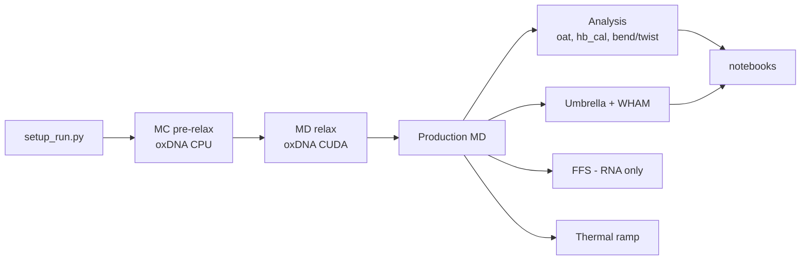

# Scripts index

Detailed, workflow-ordered guides (download and open in a browser; self-contained, phone-friendly):
[RNA.html](RNA.html) and [DNA.html](DNA.html). Version policy: [VERSIONS.md](VERSIONS.md). Cluster paths: [PORTABILITY.md](PORTABILITY.md).

| Stage | RNA | DNA |
|---|---|---|
| Setup | `rna/setup/` | `dna/setup/` |
| Relax / production | `templates/`, `jobs/` | `templates/`, `jobs/` |
| Analysis | `rna/analysis/`, `rna/multimer/` | `dna/analysis/`, `dna/multimer/` |
| Umbrella + WHAM | `rna/umbrella/` | `dna/umbrella/` |
| FFS | `rna/ffs/` | none |
| Thermal ramp | `rna/thermal_ramp/` | `dna/thermal_ramp/` |
| Plots | `notebooks/rna/` | `notebooks/dna/` |
